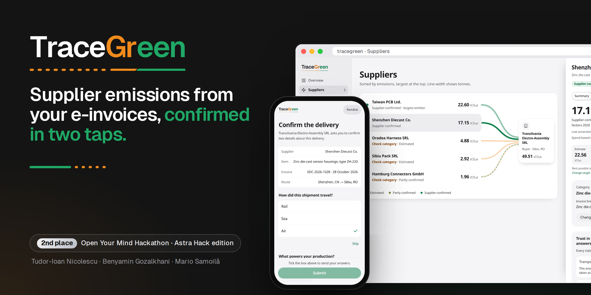
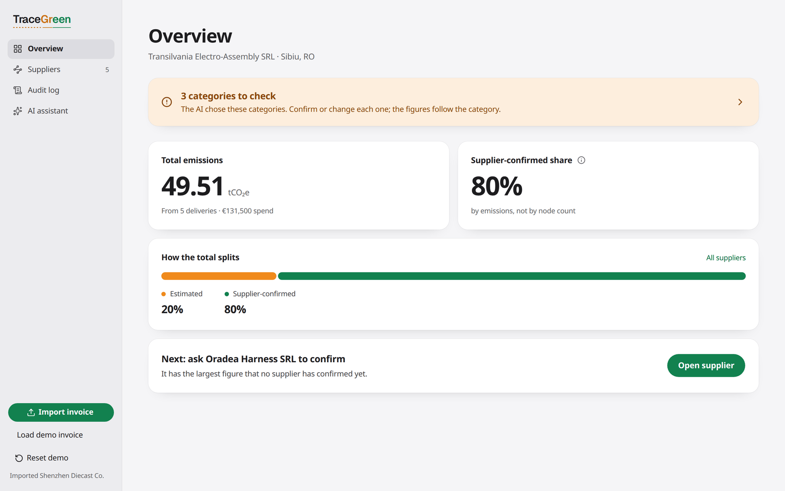
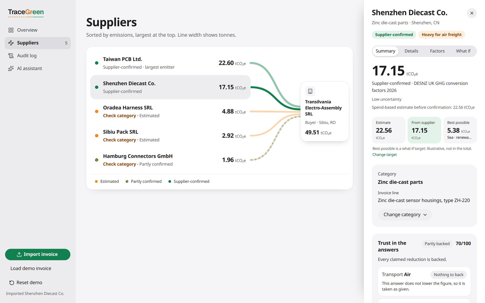
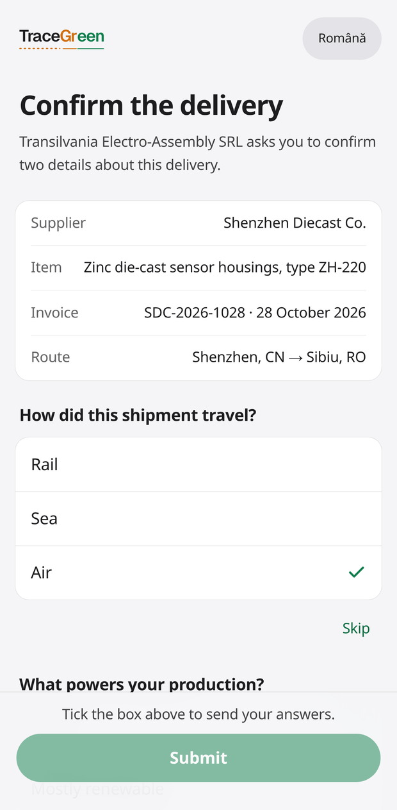
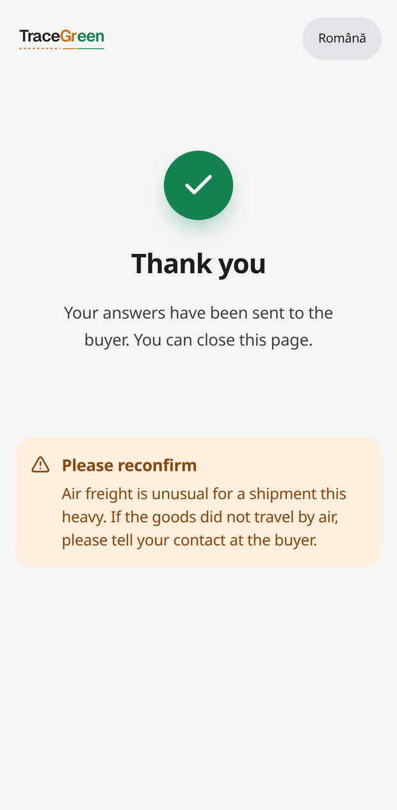
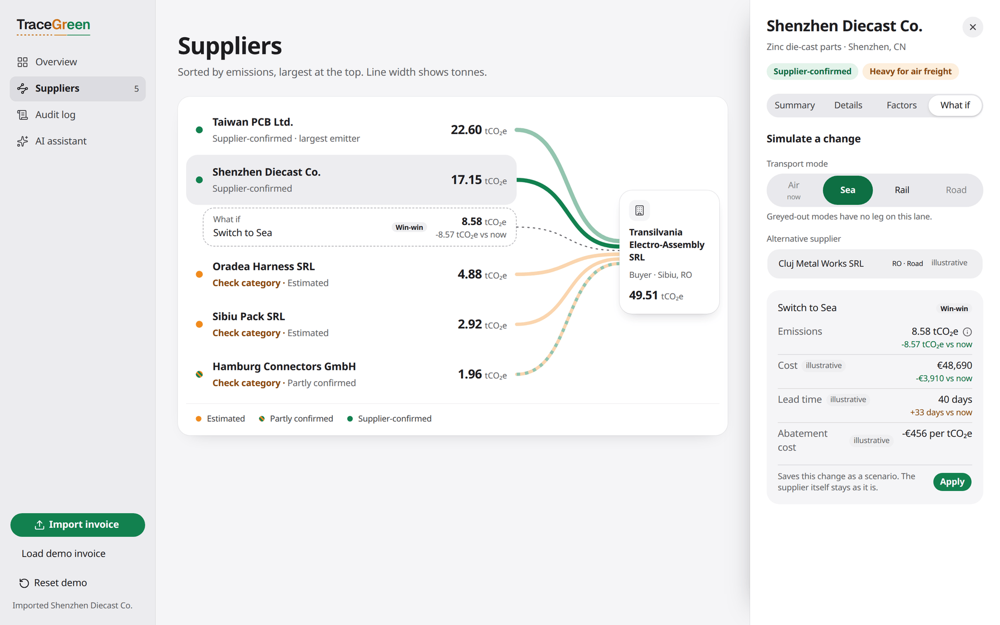
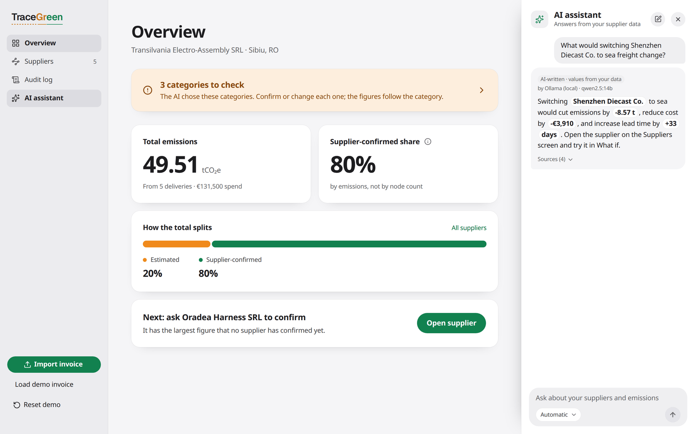
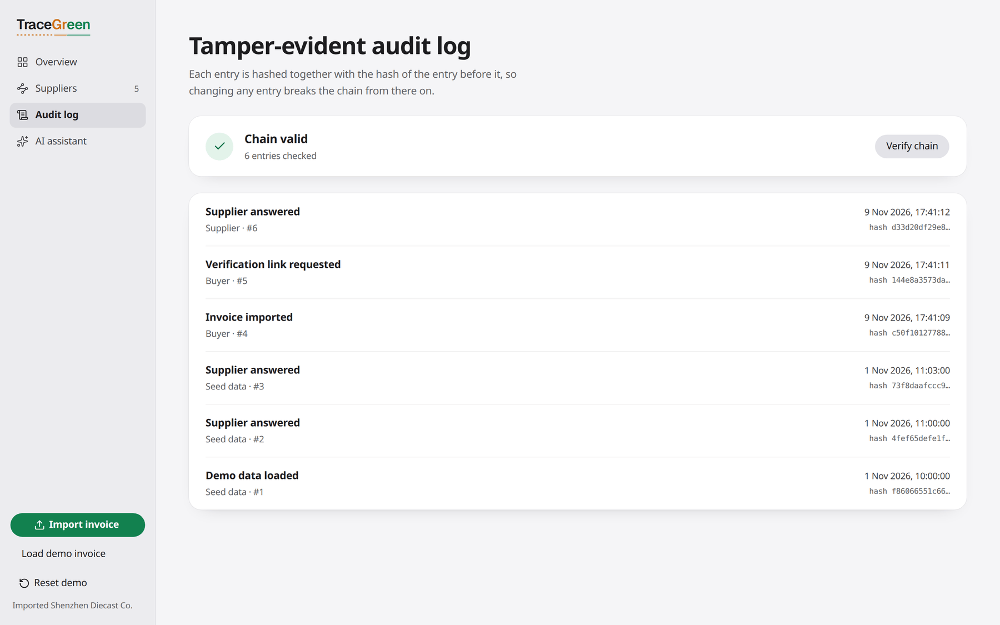
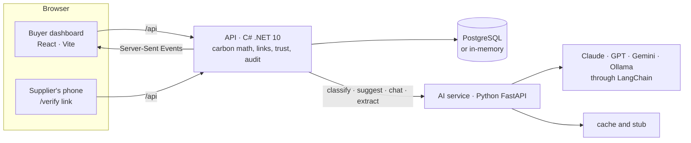

<p align="center">
  
</p>

<p align="center">
  <b>2nd place, Open Your Mind Hackathon (Astra Hack edition), Sibiu, November 2026</b><br>
  Tudor-Ioan Nicolescu · Benyamin Gozalkhani · Mario Samoilă
</p>

# TraceGreen

A manufacturer's customers ask for the emissions of the parts it sells them, but that data sits with its suppliers. Today it is collected through questionnaires by email, or estimated from how much was spent. TraceGreen turns an e-invoice into a carbon estimate for each supplier, asks the supplier to confirm two facts about the delivery from their phone, and shows the buyer what a greener choice would cost.

- **Import** a UBL 2.1 e-invoice (the format of Romania's e-Factura) and get a supplier graph with a spend-based CO₂e estimate per supplier. Every figure names its emission factor, source and year.
- **Ask** the supplier through a signed, single-use link or QR code. They answer how the delivery travelled and what powers their production in two taps, with no account and no app.
- **Check** each answer. A trust model counts an answer that lowers the figure once evidence backs it, and shows the kilograms still at risk until then.
- **Compare** a greener route or supplier: cost, carbon and lead time side by side, with a marginal abatement cost.
- **Prove** what happened: every step is recorded in a tamper-evident, hash-chained audit log.

> Every company, invoice and figure in this repository and its screenshots is fictional demo data. Lane costs and lead times are illustrative.

## A tour of the demo

### The buyer's overview



Total emissions, the **Supplier-confirmed share** (by emissions, not by node count) and the supplier to ask next. When the AI picked a supplier's category, the Overview counts it as a category to check until a person confirms or changes it.

### Suppliers and their figures



Suppliers are sorted by emissions, and each line's width shows tonnes. The side panel gives three figures per supplier:

- **Estimate:** the spend-based figure from the invoice.
- **From supplier:** the figure from the supplier's answers.
- **Best possible:** an illustrative target.

The panel also shows the trust score for the supplier's answers and the factor behind every number. In the demo, Shenzhen Diecast Co. goes from a spend-based 22.56 tCO₂e to a supplier-confirmed 17.15 tCO₂e, and the supplier-confirmed share rises from 41% to 80%.

### The supplier's side

<table>
  <tr>
    <td width="50%"></td>
    <td width="50%"></td>
  </tr>
</table>

The link opens a page in Romanian or English, with no login, cookies or app. The supplier answers two questions, ticks the Supplier Terms (never pre-ticked) and sends. The buyer's dashboard updates live over Server-Sent Events. If an answer looks implausible, the thank-you screen asks the supplier to reconfirm it. In the demo, that's air freight for a heavy shipment.

Each link is an HMAC-signed `v1.` token bound to the invoice's content hash, and it expires. It also works once: opening it again says it was already used.

### What if



The simulator tries another transport mode or one of the curated alternative suppliers. It shows the change in tonnes, euros and days, plus a badge: win-win, below the carbon price (the EU ETS price), or premium option. A change that saves no carbon is labelled "not an abatement option", never divided by zero.

### AI assistant



Buyers can ask about their own data. The model writes every value and name as a placeholder that cites a fact, and the API fills in the values itself. Before an answer is shown, the API refuses typed numbers, unknown facts, claims the data contradicts and promised actions. Answers are labelled "AI-written · values from your data", with the model that wrote them.

### Audit log



Every import, link, answer, review and scenario is appended to a log in which each entry hashes the previous one, starting from a genesis hash of 64 zeros. "Verify chain" recomputes the whole chain. Rows are never updated or deleted.

## How the numbers stay honest

- **The AI never produces a carbon number.** Every figure is computed on the server in C#, with `decimal` for money and kilograms and a guard on every division. The AI does four jobs:
  - It classifies invoice lines into an allow-list of categories. An answer below 0.6 confidence becomes `UNCLASSIFIED`.
  - It picks alternatives from a curated list.
  - It copies the fields of a PDF invoice for a person to confirm.
  - It writes chat answers that cite facts.
- **Importing never waits on a model.** Classification goes through a cache, then the configured models, then a stub, all within an 8 s budget.
- **Every figure carries its provenance.** A confirmed figure reads "Supplier-confirmed · DESNZ UK GHG conversion factors 2026". An estimate reads "Spend-based estimate · US EPA Supply Chain GHG Emission Factors v1.3". The sources and their table rows are listed in [docs/factor-sources.md](docs/factor-sources.md).
- **Nobody lies upward.** A supplier answer that raises a figure counts straight away. One that lowers it counts once something backs it: a shipping document number that passes its check digit, the buyer's customs records, or a person's review. Until then the counted figure keeps the default, and the difference is shown as kilograms at risk. See [docs/TRUST.md](docs/TRUST.md).
- **A supplier answer needs the Supplier Terms.** The verification row and the audit entry record the terms' version and SHA-256.
- **Both data modes behave the same.** The app runs in memory or on PostgreSQL, and the same repository contract tests pass in both.

## Architecture



| Service | Stack | Owns |
|---|---|---|
| [`api/`](api) | C# on .NET 10, ASP.NET Core, EF Core with Npgsql | Every carbon number, the UBL parser, signed links, the trust model, the audit chain, Server-Sent Events, the OpenAPI contract |
| [`ai/`](ai) | Python 3.12, FastAPI, LangChain, pypdf | Classifying invoice lines, picking alternatives, chat answers, PDF field extraction. Never a carbon number. |
| [`web/`](web) | React, TypeScript, Vite, Tailwind, Zustand, openapi-fetch | Renders what the API sends. Types are generated from the API's OpenAPI document. |

All three sit behind one browser origin: the web server proxies `/api` to the API.

## Run it

You need Docker.

```bash
docker compose build && docker compose up
```

This starts PostgreSQL, the API on `:8080` (migrations and the seed run on boot), the AI service on `:8000` and the web app on `http://localhost:3000`.

Try the demo path:

1. **Load the demo invoice.** Click **Load demo invoice** in the sidebar. Shenzhen Diecast Co. arrives as *Estimated* at 22.56 tCO₂e.
2. **Request data.** Open the supplier and click **Request data** to get the verification link and its QR code. To scan the QR code with a phone, set `PUBLIC_BASE_URL` to the laptop's address on a shared network ([docs/RUNBOOK.md](docs/RUNBOOK.md)).
3. **Answer on the phone.** Choose **Air** and **Grid electricity**, tick the terms and submit. The supplier turns green at 17.15 tCO₂e.
4. **Try a what-if.** Open **What if** and pick **Sea**.
5. **Check the audit log.** Open **Audit log** and click **Verify chain**.

The demo image (production builds behind nginx) runs with `docker compose -f compose.yml -f compose.demo.yml up --build`.

**AI models are optional.** Copy `.env.example` to `.env` and list them in order in `AI_MODELS`, for example `anthropic:<model>,ollama:<model>`. Keys stay in `.env` on the server. Without a model, classification falls back to the cache and the stub. The chat's suggested questions are answered from templates, so they work without a model too. Free-form chat questions and PDF import need a model. See "AI models" in [docs/RUNBOOK.md](docs/RUNBOOK.md).

## Development

| Service | Run | Test | Lint |
|---|---|---|---|
| `api/` | `dotnet run --project src/TraceGreen.Api` | `dotnet test` | warnings are errors |
| `ai/` | `uv run uvicorn app.main:app --reload --port 8000` | `uv run pytest` | `uv run ruff check . && uv run ruff format --check .` |
| `web/` | `pnpm dev` | `pnpm test` | `pnpm typecheck && pnpm lint` |

`cd web && pnpm e2e` runs the Playwright smoke over the whole demo path, both on the dashboard and on a phone-sized page. It runs against a running stack and resets the demo workspace before it starts.

CI runs on every pull request in `.github/workflows/ci.yml`. It covers:

- the API build and tests against PostgreSQL;
- the AI service's tests and lint;
- the web app's typecheck, lint, tests and build;
- a check that `web/src/api/schema.d.ts` matches the running API;
- the Playwright smoke on the demo image, in both data modes.

## Repository

```
api/      .NET 10 solution: Domain (pure C#), Infrastructure (memory + Postgres), Api (host)
ai/       FastAPI service, prompts, tests with fake models, evaluation set
web/      React SPA, generated API types, Playwright e2e
seed/     fictional invoices (UBL XML and a PDF), factors, lanes, alternatives, Supplier Terms
scripts/  Node .mjs tools: preflight, ANAF seed validation, terms hash
docs/     architecture, decisions, trust model, security, runbook, factor sources
```

## Documentation

- [Architecture](docs/ARCHITECTURE.md): how the pieces fit together
- [Decisions](docs/DECISIONS.md): what was decided and why
- [Supplier trust](docs/TRUST.md): how supplier answers are weighed
- [Security](docs/SECURITY.md): tokens, rate limits, row-level security, CSP
- [Runbook](docs/RUNBOOK.md): development, the demo laptop and the demo steps
- [Factor sources](docs/factor-sources.md): every emission factor, with its table, year and row
- [Status](docs/NEXT.md) and [roadmap](docs/ROADMAP.md)
- [Supplier Terms and their legal basis](docs/legal/README.md)

## Team

Built by **Tudor-Ioan Nicolescu**, **Benyamin Gozalkhani** and **Mario Samoilă**, with Claude Code as a fourth pair of hands. The core (import, links, simulator, audit log) was built in the weeks before the hackathon. The real AI models, the PDF import, the supplier page and the trust model were built during the 24 hours.
