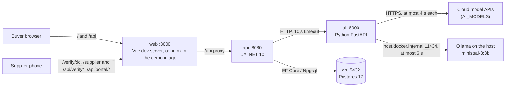
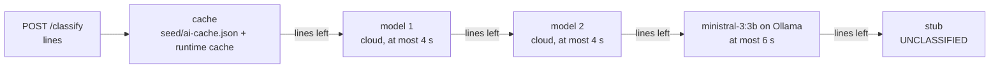
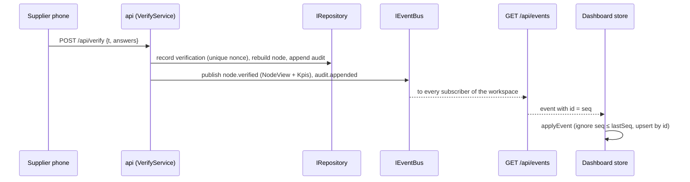

# Architecture

TraceGreen turns a UBL 2.1 e-invoice into a supplier node with a spend-based CO₂e estimate, lets the supplier confirm it through a signed single-use link, and shows the buyer the cost, carbon and lead-time trade-off of a greener choice. This page covers the services, the C# layers with their ports and adapters, the read model, the event flow and the two data modes. How to run it: `RUNBOOK.md`. Why it is built this way: `DECISIONS.md`. Security controls: `SECURITY.md`.

## Services



| Service | Owns | Never does |
|---|---|---|
| `api/` (C# .NET 10) | Parsing, every carbon number, the KPIs, links and verification, the audit chain, scenarios, the event stream, the OpenAPI contract | Trusts the AI with a number |
| `ai/` (Python FastAPI) | Line-item classification through the cache, then the models in `AI_MODELS`, then a stub, within 8 s, with the allow-list and a 0.6 confidence threshold enforced (see "Inside the AI service"); `/suggest` answers empty | Computes carbon; returns a category outside the allow-list |
| `web/` (Vite + React SPA) | Rendering the graph, the KPI bar, the drawer, the link card, the audit panel and the supplier page | Computes carbon or KPIs; hand-writes API types |

The browser and the phone see one origin: in development the Vite server proxies `/api`, and in the demo image (`compose.demo.yml`) nginx serves the built SPA and proxies `/api` and `/openapi`. The phone reaches the laptop over the laptop's hotspot (`RUNBOOK.md`).

## Inside the API

Three projects, with dependencies pointing inward:

```
TraceGreen.Api ──► TraceGreen.Infrastructure ──► TraceGreen.Domain
      └──────────────────────────────────────────────►┘
```

- **`TraceGreen.Domain`** is pure C# with no package references:
  - model records (`Model/`), including the read model `ReadModel.cs`;
  - carbon math (`Carbon/`: `FactorTable`, `Estimate`, `SpendConversion`, `KpiCalculator`, `Mac`, `Simulator`);
  - the UBL parser (`Ubl/`);
  - canonical JSON, hashing and the HMAC link signer (`Security/`);
  - the audit chain (`Audit/`) and the plausibility rules (`Plausibility/`);
  - seed loading (`Seed/`), the ports, and the use-case services (`Services/`).
- **`TraceGreen.Infrastructure`** holds the adapters: `Memory/` (repository and event bus), `Postgres/` (EF Core repository and migrations) and `Ai/` (HTTP client and stub).
- **`TraceGreen.Api`** is the host:
  - `Program.cs` wires everything; `AppConfig` reads the environment and fails fast.
  - `Endpoints/*.cs` are thin (parse → service → status).
  - `ApiJson` is the one JSON shape, and `Problems` holds `ApiProblem` with a stable `code`.
  - Also here: the OpenAPI transformers, `BaseUrlResolver`, and `StartupTasks` (`--migrate --seed --reset --exit`).

### Ports and adapters

| Port (Domain) | Adapters (Infrastructure) | Notes |
|---|---|---|
| `Ports/IRepository` | `MemoryRepository`, `EfRepository` | Buyer, invoices, nodes, verifications, audit, scenarios, factors, lanes, alternatives, `SeedAsync`. Both pass the same contract tests. |
| `Ports/IEventBus` | `InMemoryEventBus` | `Publish`, `Subscribe`, `ReplaySince`, `LastSeq`. A ring buffer of 500 events per workspace, with a sequence number per event. |
| `Ai/IAiClient` | `HttpAiClient`, `StubAiClient` | `ClassifyAsync`, `SuggestAsync`, `HealthAsync`. `LineClassification` tries the invoice's own code (a CPV or HS prefix in `seed/classification-map.json`), then `seed/ai-cache.json`, then the AI within its timeout, then the stub. |
| `Security/ILinkSigner` | `HmacLinkSigner` (Domain) | Mints and checks `v1.` tokens (`SECURITY.md`). |

### Use-case services

All live in `Domain/Services`. Each takes the ports, `TimeProvider`, the `SeedBundle` and a `ServiceOptions` record that `Program.cs` builds from `AppConfig`.

| Service | Routes | Writes | Publishes |
|---|---|---|---|
| `GraphService` | `GET /api/graph` | — | — |
| `IngestService` | `POST /api/ingest/ubl` | invoice + node, audit entry | `node.created`, `audit.appended` |
| `DemoService` | `POST /api/ingest/demo`, `POST /api/dev/reset` | N1 with fixed ids; reset to seed | as ingest; `graph.reset` |
| `LinkService` | `POST /api/request-link` | audit `link.requested` | `audit.appended` |
| `VerifyService` | `GET /api/verify/context`, `POST /api/verify` (needs the Supplier Terms' SHA-256), `POST /api/dev/simulate-answer`, `POST /api/audit/verify` | verification row with the accepted terms, rebuilt node, audit entry | `node.verified`, `audit.appended` |
| `ScenarioService` | `POST /api/simulate`, `POST /api/scenarios` | a scenario (save only) | `scenario.saved` |
| `PortalService` (F12) | `POST /api/portal-link`, `POST /api/portal/view`, `POST /api/portal/answer` (needs the Supplier Terms' SHA-256) | audit `portal.requested`; an answer goes through `LinkService` and `VerifyService` | `audit.appended`; an answer publishes what a verification publishes |

`NodeFactory` builds a node from an invoice and, after an answer, from the answers, for the seed and for imports alike. `NodeViewMapper` turns a stored node into the read model.

## Inside the AI service

The API sends only the lines its own rules could not classify (no code that `seed/classification-map.json` matches, no entry in `seed/ai-cache.json`). The AI service answers them in one batch within `AI_TIMEOUT_S` (8 s), so it replies before the API's 10 s timeout:



- `config.py` reads `AI_MODELS` (`<provider>:<model>`, in order) into model specs, each with a ready flag and a reason (a missing key, for example). While `AI_MODELS` is empty, the older `AI_MODEL` counts as `anthropic:<AI_MODEL>`.
- `models.py` builds each LangChain chat model lazily: temperature 0, no retries, its own timeout. No client exists while no model is configured.
- `prompts.py` lists the allowed category ids and labels from `seed/categories.json` and puts the invoice lines in an `<invoice_lines>` block that the prompt declares to be data.
- `providers.py` runs the chain. It sends the lines left over to the next ready model in one structured-output call, checks the answer (`SECURITY.md`, "The AI boundary"), and turns any answer below 0.6 confidence into `UNCLASSIFIED`. Each model call runs in a worker thread with a hard deadline. Model answers are kept in a runtime cache under the same key as `seed/ai-cache.json`, until the service restarts.
- `main.py` adds `models` to `/health` and, only with `AI_DEV_ROUTES=1`, `POST /classify?model=<id>`, which asks that one model and skips the cache (scoring, `docs/ai-eval.md`).

## The read model

`NodeView` (in `Domain/Model/ReadModel.cs`) is the single node shape on the wire. It appears in the snapshot and in every node event. It carries:

- `status` (`ESTIMATED | PARTIAL | VERIFIED`) and `carbonKg` with its `basis`. The basis is `spend` until VERIFIED, then `activity`.
- both figures, each with the `FactorLookup` rows behind it: value, unit, source, year and row label. These rows feed the "i" icon, and a `PLACEHOLDER` source is shown as it is.
- `uncertainty` (ruling R4), `classification` (with `aiMapped` for the "AI-mapped" label and `rationale`, the one-line reason behind the category, shown only when AI-mapped), the `invoice` summary, the `lane` (illustrative), `alternatives` for the simulator, plausibility `warnings`, cost and lead days.

`GraphSnapshot` (`GET /api/graph`) contains the buyer, every `NodeView`, the `kpis`, the whole audit chain, `lastSeq` and the data mode. The KPIs come from `KpiCalculator` on the server, and every node event carries fresh ones, so the SPA never adds up carbon. The hotspot ring is a selector over the nodes, not a stored state.

The OpenAPI document at `/openapi/v1.json` describes all of this, including `/api/events` as a `text/event-stream` of the `DomainEvent` union. `web/src/api/schema.d.ts` is generated from it (`pnpm gen:api`) and committed, and the types-drift job in CI fails if the two differ.

## Event flow



1. A service writes through the repository, then publishes. The bus gives each event the next sequence number of its workspace and keeps it in the ring buffer.
2. `GET /api/events` subscribes, then sends `hello` carrying the current `lastSeq`. If the client reconnects with `Last-Event-ID`, the stream replays from the buffer, or sends `resync` when the gap is no longer buffered. After that it streams events, with a `ping` every so often.
3. On the client, `useGraphEvents` runs `startGraphSync` over the pure `graphSync` reducer:
   - **When it fetches the snapshot:** on every stream (re)open, on `resync`, on `graph.reset` and on a sequence gap.
   - **How it applies events:** idempotently, on top of the snapshot.
   - **When the stream is down:** it polls `/api/graph` every 5 s.
   - **What the badge shows:** `connecting | live | polling | offline`.
4. A verification therefore reaches every open dashboard in one event: the rebuilt `NodeView` and the new KPIs. M1 measured an import's response in 15–70 ms; the goal for the flip is under 2 s over the hotspot.

## Data modes

`DATA_MODE` picks the repository. When it's unset, the API uses Postgres if `DATABASE_URL` is set and memory otherwise; `SEED_MODE=1` is an alias for memory.

| | `memory` | `postgres` |
|---|---|---|
| Repository | `MemoryRepository`, lock-atomic per workspace | `EfRepository`; an advisory lock per workspace serialises writes |
| Single use | nonce set under the lock | unique index on the nonce |
| Audit | chain kept in order under the lock | unique `(workspace_id, prev_hash)`; append-only trigger; RLS enabled |
| Reset | clears the workspace, then seeds | `TRUNCATE`, then seeds |
| Survives a restart | no (`lastSeq` restarts at 0, which the SPA accepts) | yes |
| Seeding | `IRepository.SeedAsync` from `seed/` at boot | the same, through `--migrate --seed` (Compose runs it on boot) |

The event bus is in memory in both modes. Every feature works in both modes, and the repository contract tests run against memory every time and against Postgres when `DATABASE_URL` is set, as CI does.

## Seed data

`seed/` holds the fixtures: five UBL invoices plus an adversarial one, three Romanian invoices (R1–R3) for the AI and HS-rule paths that the demo state leaves out, the classification map (CPV and HS code prefixes), the factors with their provenance, the spend-conversion tables, the lanes (illustrative), the alternatives, the categories (also the AI allow-list), the AI cache, the demo state and the Supplier Terms (`supplier-terms.json`, hashed at load, each published version pinned in `supplier-terms-versions.json`, served by `GET /api/terms/supplier` without a service; `docs/legal/README.md`). All of it uses fixed UUIDs. `SeedLoader` validates it at startup, for example every lane an invoice or alternative names. Data provenance and the placeholder rows still waiting for real sources are in `docs/factor-sources.md`.
